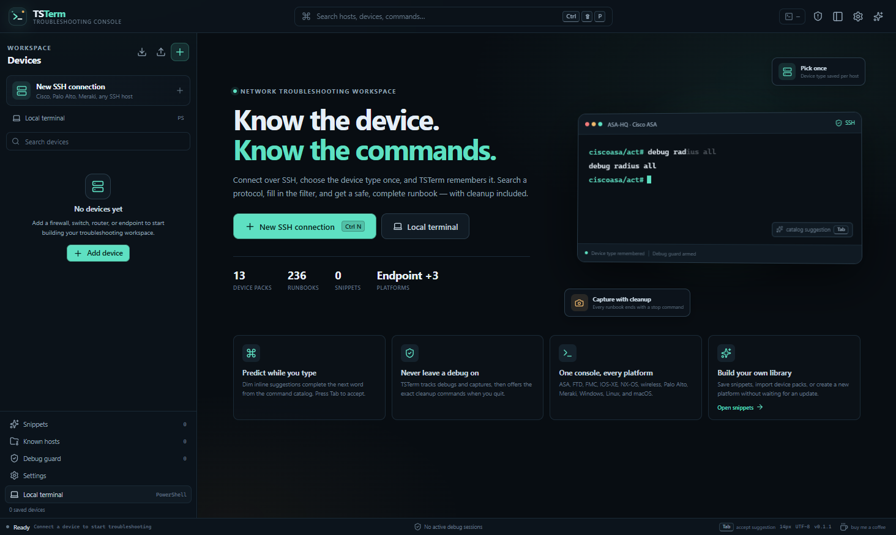
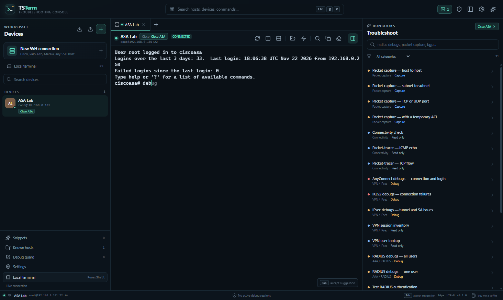
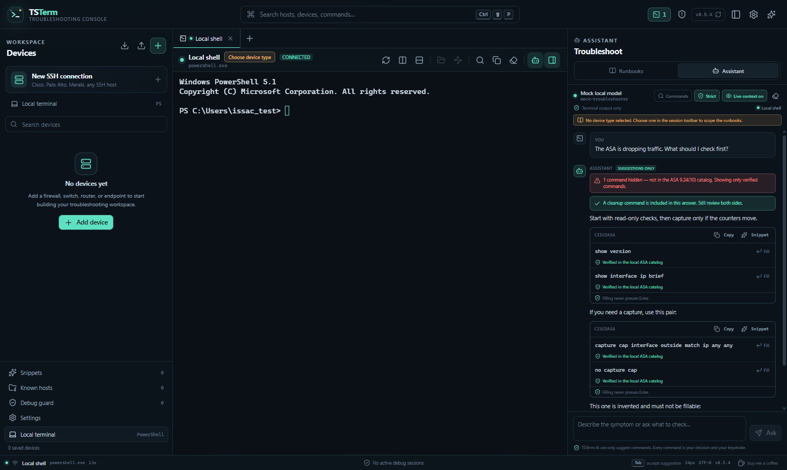
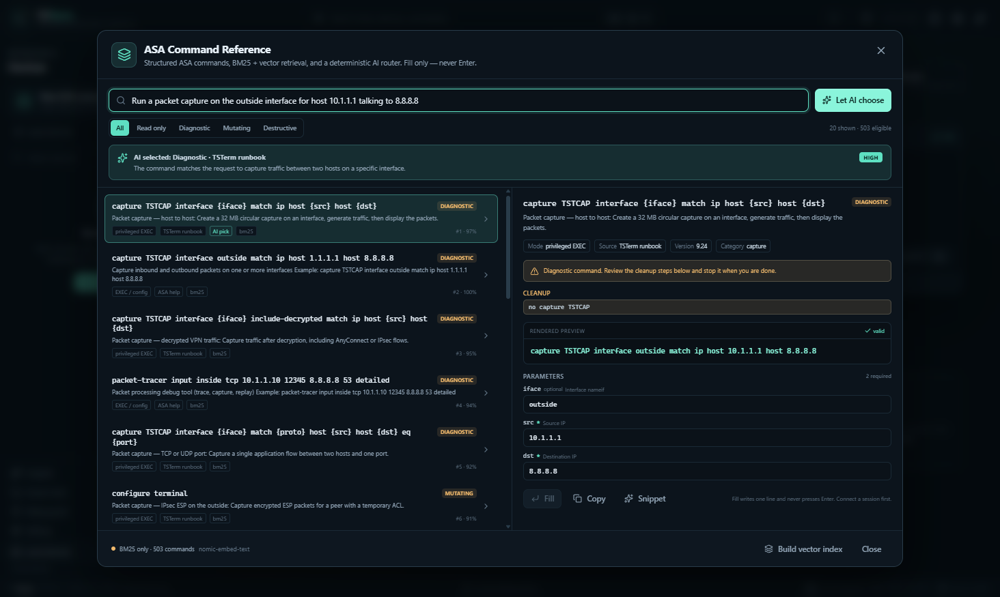
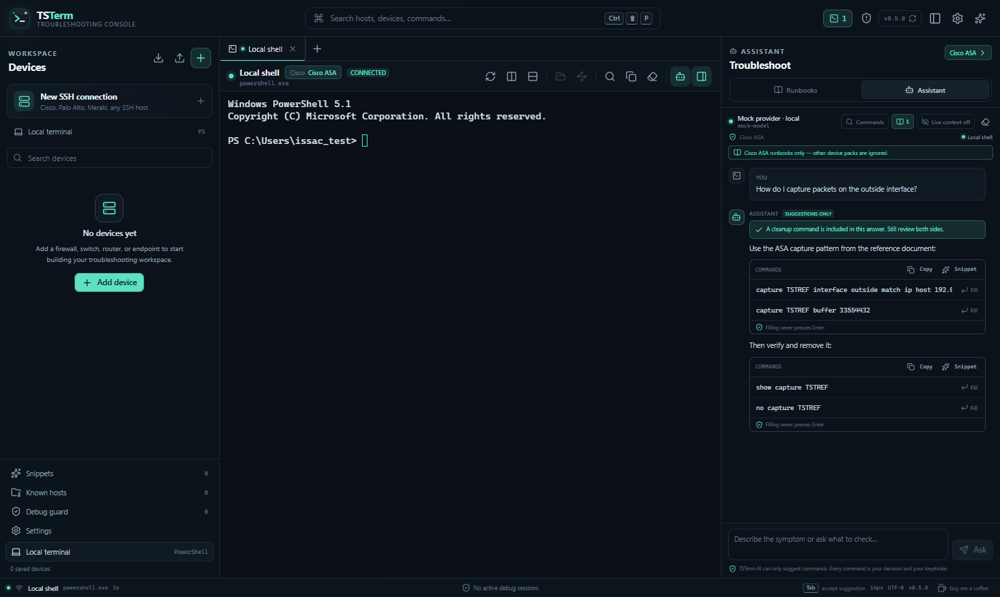
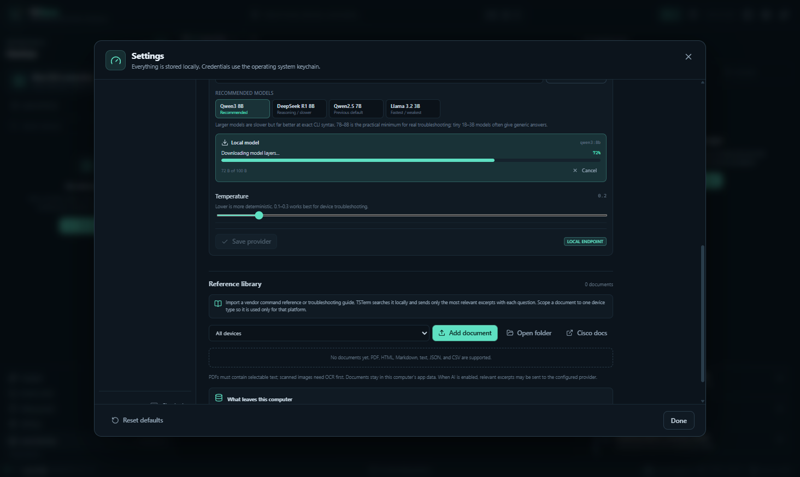
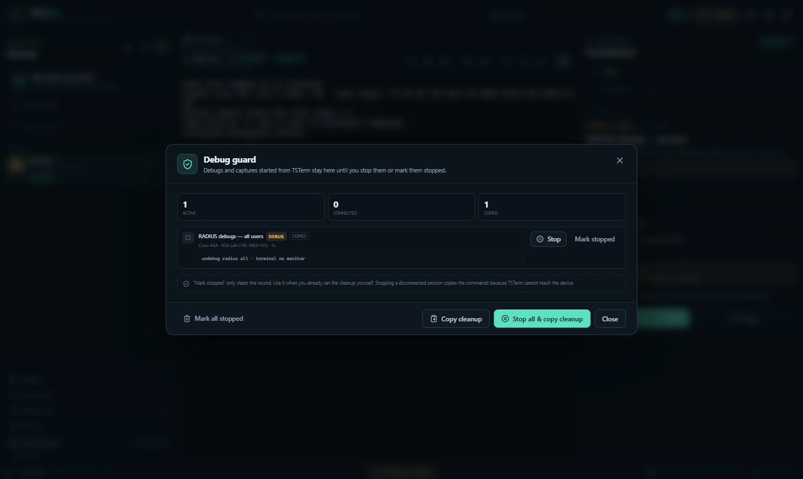
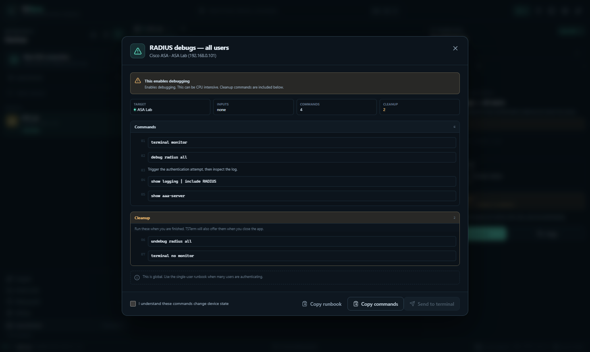
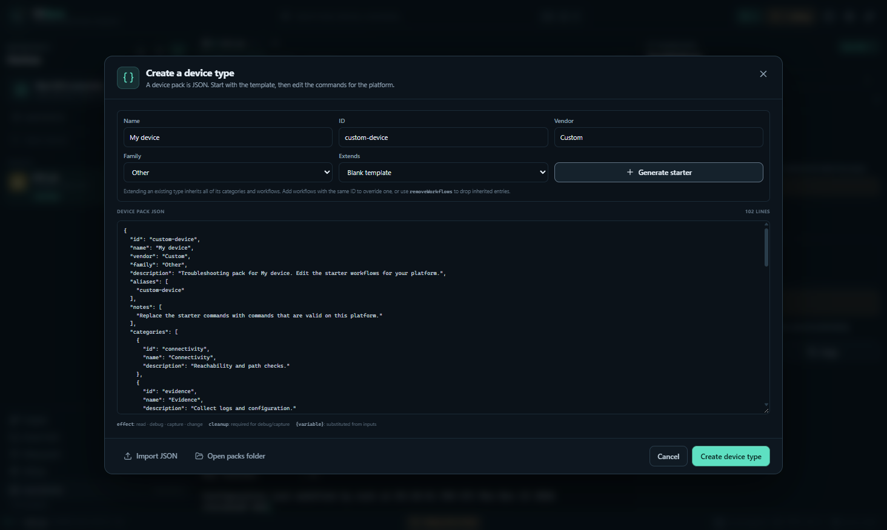
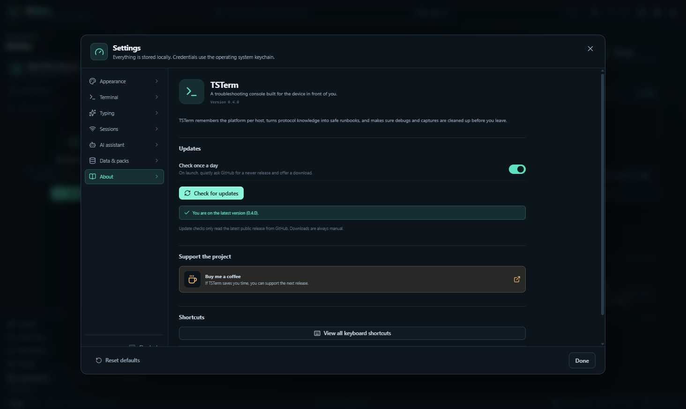

# TSTerm

**A troubleshooting console for the device in front of you.**

TSTerm is a desktop terminal for network and system engineers. It remembers what kind of device a host is,
turns a protocol into a safe, complete runbook, and makes sure the debugs and packet captures you start are
cleaned up before you walk away.

It is built for the messy middle of an incident: the part where you know *what* is wrong but still need the
exact Cisco ASA command that gets you the next piece of evidence. This build focuses on ASA; other device
packs are archived and will return one at a time after validation.



## Why it exists

Most troubleshooting tools stop at “here is a command.” TSTerm goes the rest of the way:

- You connect once and **TSTerm remembers the device type** for that host.
- You type `deb` and a **dim next-word prediction** appears inline. Press `Tab` to accept it.
- You choose a symptom, fill in one or two filters, and get a **runbook with verify and cleanup**.
- If you leave a debug or capture running, TSTerm **asks before quitting** and sends the cleanup to every
  live session. If a device is already disconnected, it copies the cleanup and writes a file you can use later.

No browser tabs full of half-remembered commands. No forgotten `undebug all` at 02:00.

## What is inside

### A terminal built for troubleshooting

- Real SSH sessions and a local shell (PowerShell on Windows, `$SHELL` on macOS/Linux).
- Tabs and split panes.
- Multiple terminal themes, live font changes, font size/line height/spacing, cursor styles, scrollback.
- Copy on select, right-click copy/paste, clickable links, Ctrl+F search, and font zoom.
- SFTP browser, local port forwarding, jump hosts, session logs, known-host pinning, and encrypted credentials.
- Session logging and a configurable keepalive.
- An optional AI troubleshooting partner that can suggest and stage commands but can never execute them.

### Device-aware runbooks

The bundled catalog currently contains **Cisco ASA only: 77 runbooks across 14 categories**. The other
packs are kept in `catalog-archive/` and are being validated one at a time before they return to the
installer.

| Platform | What is covered |
| --- | --- |
| Cisco ASA | **77 runbooks** — VPN, AnyConnect, IKEv1/IKEv2/IPsec, RADIUS/TACACS+/LDAP/User-ID, captures (host, subnet, ACL, ASP drop, decrypted), NAT, OSPF/EIGRP/BGP/multicast/IPv6, failover and clustering, licenses, logging, threat detection, and more |

Every workflow can carry variables, required inputs, validation, instructions, notes, verification steps,
and **cleanup commands**. Debug and capture workflows are not allowed to load without cleanup.

### Inline next-word predictions



As you type, TSTerm shows a dim completion after the cursor — never as bright as what you have typed.
Predictions come from the active device pack, your snippets, and recent commands in the session.
`Tab` accepts, `Esc` dismisses. Password prompts and full-screen programs are excluded.

### Optional AI troubleshooting partner



TSTerm can hold a troubleshooting conversation with a **local model (Ollama or LM Studio)** or a provider
you already subscribe to. It is **off by default** and is configured separately in
**Settings → AI assistant**.

Ollama users do not need to run `ollama pull`. When the assistant is enabled, TSTerm checks the local
Ollama server and automatically downloads the selected model through Ollama's pull API, with live progress
and a cancel button. The download continues if you close Settings, and can be turned off with
**Download local models automatically**.

Responses stream token by token, so answers appear while the model is still writing. **Qwen3 8B** is the
recommended local model for network CLI work and for the command router; 1B–3B models are often generic,
and TSTerm warns when one is selected. Device type and matching runbooks are always sent to the model;
live terminal lines remain opt-in.

The AI is **scoped to the active device pack**. An ASA session receives ASA runbooks only; other packs are
excluded from the prompt. This build ships the ASA pack only, so a local terminal has no vendor runbooks
until another pack is restored.

Every terminal keeps its **own AI conversation**. Messages, drafts, errors, and an in-flight streamed answer
belong to that terminal's tab. Switch to another device and the new tab starts with a clean thread; switch
back and the previous conversation and draft are exactly where you left them. Replies that finish while you
are on another tab are delivered to the correct thread. Closing a tab clears that terminal's thread.
Ollama reuses the loaded model across threads, so separate conversations do not reload or duplicate the
model in VRAM.

Assistant replies are **grounded in the local ASA catalog**. Every fenced, inline, and standalone command line is
checked. In strict mode, only curated commands and device-help commands present on ASA 9.24(10) are rendered;
anything else is removed before display and reported as hidden. Exact curated matches show **Verified in the
local ASA catalog**, device-help matches show **Device help 9.24(10) — reference only**, Cisco documentation is
hidden, and unknown commands are hidden. Copy and Snippet only use the verified lines. **Strict command
grounding** is on by default and can be toggled in AI settings. Explicit command requests such as “what command
shows interface errors?” switch the button from **Ask** to **Find command** and open the command browser with
the question as the query instead of calling the model.

### ASA command reference and deterministic router



**Session → ASA Command Reference** (`Ctrl+Shift+J`) opens a searchable catalog of **27,499 ASA command
records**:

- **514 fillable records**: 503 curated commands plus 11 live-verified capture records.
- **24,475 device-help records** normalized from a read-only `?` crawl of ASA 9.24(10), including mode,
  category, parameter placeholders, and inferred risk. They are version-specific references, not fillable.
- **2,510 Cisco documentation reference entries** imported from the official ASA A–H, I–R, S, and T–Z
  command reference.

Search runs locally with BM25. The 514 fillable records can also be embedded once with Ollama and merged
with reciprocal rank fusion; the device-help and documentation entries stay BM25-only. Reference entries show
documented syntax, modes, risk, and a link to Cisco where available, but **Fill is disabled** because they are
not parameterized yet.

The **Let AI choose** action is different from free chat. The model receives only the top fillable
candidate records and returns JSON with a candidate ID and extracted parameter values. TSTerm rejects any
ID that was not retrieved, drops any value that is not present in your question or terminal output,
validates each parameter, and renders the command from the curated template. The model never writes the
command string, and documentation-only entries are never routed.

Every record is classified as read-only, diagnostic, mutating, or destructive. Diagnostic records show
their cleanup, and destructive records require typing `CONFIRM` before **Fill** is enabled. Fill writes
one line and never presses Enter.

The full design, schema, retrieval rules, and limitations are in
[docs/COMMANDS.md](docs/COMMANDS.md).

### Reference library



Import command references or vendor guides in **Settings → AI assistant → Reference library**. PDF, HTML,
Markdown, text, JSON, CSV, and log files are supported. Each document can be scoped to one device type or
all devices.

TSTerm keeps the document locally, splits it into sections, and retrieves only the most relevant excerpts
for each question. The excerpt and its document name are added to the AI prompt as reference data. PDFs
must contain selectable text; scanned images need OCR first.

If Ollama itself is missing, **Install Ollama** runs the official `Ollama.Ollama` winget package on
Windows and then continues with the model download. On macOS and Linux, TSTerm opens the official download
page and resumes the same automatic check once Ollama is running. Ollama only needs to be installed once.



The boundary is deliberate and enforced in the app architecture:

- The AI process has **no terminal, SSH, file, or IPC execution access**.
- It returns text and fenced command blocks. You review every line.
- **Fill** writes exactly one line into the current prompt and never presses Enter. It refuses to write
  when the terminal is at a password prompt or inside a full-screen program.
- Command parsing strips device prompts, ANSI sequences, control characters, and bidi overrides.
- `Copy` and `Snippet` are explicit actions; nothing runs automatically.
- Context is opt-in. When enabled, TSTerm sends the device type, matching runbook hints, the current
  command line, and the last 400 terminal lines (up to 24,000 characters). Common password/secret fields are
  redacted first.

Cloud API keys are encrypted with Electron `safeStorage` and are never returned to the renderer. Local
endpoints such as `http://127.0.0.1:11434/v1` keep the conversation on your machine. Each request goes
through the Electron main process, so the renderer never receives terminal-execution capability.

Free chat also retrieves the top six matching command records from the local ASA catalog, including
version-tagged device-help references. Follow-up questions such as “why did that fail?” automatically
include recent `%ASA-...` syslog IDs and the last terminal command in the retrieval query. Runbook matching
is partial and stemmed, so natural-language questions are not rejected just because one word is missing.
When you open the command reference with automatic local model downloads enabled, TSTerm installs
`nomic-embed-text` if needed and builds the fillable-command vector index in the background. Ollama requests
disable thinking tokens with `think: false`; DeepSeek R1 receives a larger answer budget, and literal
`<think>` blocks are filtered from the stream.

Runbook details include an **Ask AI** action that opens the assistant with that workflow as the topic, so
you can ask what to verify before and after without retyping the commands.

### The debug guard



When you send or copy a debug or capture runbook, the session is tracked. On app close you get a clear
prompt:

- **Stop debugs & quit** — sends cleanup to connected sessions, copies it, and writes a cleanup file.
- **Quit without stopping** — leaves the device as-is; the record survives and is shown next launch.
- **Cancel** — stays in the app.

The guard is a safety net, not a substitute for judgment. If the app is killed or the network fails at the
worst moment, use the copied cleanup file and verify the device state.

### Runbooks you can read before you run



Commands are shown as a numbered runbook with notes, verification, cleanup, and a state-change
acknowledgement. You can copy commands, copy a documentation runbook, or send them one line at a time to
the active terminal.

### Your own device packs



Create a device type from the UI, import a JSON pack, or extend an existing pack and override only the
workflows you need. The custom catalog lives outside the app bundle, so updates never overwrite it.

See [docs/DEVICE_PACKS.md](docs/DEVICE_PACKS.md) for the format and a full example.

### Updates and support



TSTerm checks the public GitHub release feed **once a day** on launch. The current version is always
visible in the top bar next to a quick **Check for updates** button; the same check is available in
Settings → About. If a newer version exists, you can download it, skip that version, or turn automatic
checks off. Nothing is installed without you.

If TSTerm saves you time, there is a small **Buy me a coffee** link in the status bar and in Settings:
[buymeacoffee.com/issac_john](https://buymeacoffee.com/issac_john).

## Install and run

Requirements: **Node.js 22+**, Git, and the usual platform build tools for `node-pty`.

```bash
git clone https://github.com/issacjohn/tsterm.git
cd tsterm
npm install
npm run dev
```

Build and preview:

```bash
npm run build
npm start
```

Create a desktop installer:

```bash
npm run dist
```

Artifacts land in `release/`. The first Windows build is unsigned, so SmartScreen may ask you to confirm
before launching it. The installer is built from this source and contains the bundled catalog.

### If npm blocks install scripts

Recent npm versions can hold install scripts until approved. TSTerm needs Electron, esbuild, ssh2, and
node-pty to finish their install scripts. If `npm install` reports them as blocked, approve them and
rebuild:

```bash
npm install-scripts approve electron
npm install-scripts approve esbuild
npm install-scripts approve node-pty
npm install-scripts approve ssh2
npm rebuild
```

On Linux, install build tools first (`build-essential`, `python3`, `make`, `g++`). On macOS, install the
Xcode command line tools.

## First five minutes

1. Click **New SSH connection** and enter the host, username, and password (or choose a private key).
2. Leave the device type as **Ask me on the first connection**. TSTerm asks for the CLI family after the
   first successful login and remembers it.
3. Open the **Troubleshoot** panel on the right and search for a symptom, e.g. `radius debugs`, `packet
   capture`, `bgp`, `dns`, or `pktmon`.
4. Fill in the filter variables and open the runbook. Review the commands and cleanup.
5. Type directly in the terminal when you prefer. Use `Tab` to accept the dim suggestion.

Changing the device type later is easy: click the device chip in the session toolbar, or use the host's
menu → **Set device type**.

## Keyboard shortcuts

| Action | Shortcut |
| --- | --- |
| New SSH connection | `Ctrl/Cmd + Shift + N` |
| Local terminal | `Ctrl/Cmd + Shift + T` |
| Command palette | `Ctrl/Cmd + Shift + P` |
| Settings | `Ctrl/Cmd + ,` |
| Close tab | `Ctrl/Cmd + Shift + W` |
| Toggle troubleshooting panel | `Ctrl + Shift + K` |
| AI assistant (or setup) | `Ctrl + Shift + A` |
| Debug guard | `Ctrl + Shift + D` |
| Find in terminal | `Ctrl + F` |
| Copy / paste terminal selection | `Ctrl + Shift + C` / `Ctrl + Shift + V` (macOS: `Cmd + C/V`) |
| Accept prediction | `Tab` |
| Font zoom | `Ctrl + =` / `Ctrl + -` / `Ctrl + 0` |
| Quit | `Ctrl + Q` (macOS: `Cmd + Q`) |

The full list is in **Help → Keyboard shortcuts** (`F1`).

## Custom device packs

A device pack is JSON. The minimum is a device type with categories and workflows. A workflow can be a
single command or a multi-step procedure with variables and cleanup.

```json
{
  "id": "my-platform",
  "name": "My platform",
  "vendor": "Acme",
  "family": "Firewall",
  "description": "Troubleshooting pack for Acme OS.",
  "categories": [
    { "id": "connectivity", "name": "Connectivity" }
  ],
  "workflows": [
    {
      "id": "reachability",
      "title": "Reachability check",
      "category": "connectivity",
      "summary": "Ping and trace the target.",
      "keywords": ["ping", "traceroute"],
      "severity": "info",
      "effect": "read",
      "variables": [
        { "name": "dst", "prompt": "Target IP", "type": "ip", "required": true }
      ],
      "steps": ["ping {dst}", "traceroute {dst}"]
    }
  ]
}
```

Use **Settings → Data & packs → New device type** to generate a starter pack, save it, and edit the JSON in
place. Packs are validated before they are loaded. If something is wrong, the app tells you which file and
which field, and keeps the rest of the catalog usable.

The full schema, inheritance rules, variable types, conditions, and cleanup requirements are in
[docs/DEVICE_PACKS.md](docs/DEVICE_PACKS.md). A JSON Schema is available at
[schemas/device-pack.schema.json](schemas/device-pack.schema.json).

## Testing

Unit tests:

```bash
npm test
npm run typecheck
npm run build
```

There are tests for catalog loading and inheritance, runbook rendering, variable validation, the inline
suggestion engine, the daily GitHub update check, AI command parsing and secret redaction, and the AI
execution boundary.

The UI smoke test drives the real Electron app, creates a host, connects over SSH, checks the device-type
and host-key prompts, verifies the remembered type on a second connection, types a command, exercises
inline suggestions, copies a debug runbook, opens the debug guard, creates a snippet and a device pack,
tests both themes and font changes, exercises the quit guard, and opens a local PowerShell session.

```bash
TSTERM_TEST_HOST=192.0.2.10 \
TSTERM_TEST_USER=admin \
TSTERM_TEST_PASSWORD=secret \
npm run test:ui
```

Several opt-in tests are included:

```bash
# Runs the AI opt-in, provider, key, chat, and fill-without-Enter flow against a local mock model
npm run test:ai

# Simulates Ollama, verifies the automatic model pull, progress, background completion, and chat
npm run test:ai-local

# Checks the missing-runtime UI offers Install Ollama instead of a misleading Download button
npm run test:ai-runtime

# Verifies ASA-only runbook scope and imported reference retrieval
npm run test:ai-reference

# Verifies separate per-terminal conversations, drafts, and background completion
npm run test:ai-threads

# Opens the ASA command browser, searches, filters, and checks Fill-only behavior
npm run test:commands-ui

# Requires Ollama plus qwen3:8b and nomic-embed-text; builds the vector index and routes real questions
$env:TSTERM_OLLAMA_TEST = '1'; npm test -- tests/commands-ollama.test.ts

# Requires Ollama plus qwen3:8b; sends a real streaming prompt through TSTerm
npm run test:ai-ollama

# Starts a real RADIUS debug, quits through the guard, and checks the cleanup with show debug
npm run test:debug-guard

# Checks the live GitHub release feed from the app
npm run test:update

# Launches the packaged Windows build and checks the local shell
npm run test:packaged
```

The debug test is the only one that changes a device, and it restores the debug state before it finishes.
The AI test uses a loopback mock server and never contacts a real provider.
See [docs/TESTING.md](docs/TESTING.md) for the details.

**Lab verification:** the included UI tests and a live debug-cleanup test were run against a
**Cisco ASA Software 9.24(10)** appliance. Confirmed:

- SSH login, first-use host key prompt, and trusted-key reuse.
- Device type selection and memory across a second session.
- `show version`, the runbook panel, and inline `deb` → `debug` prediction.
- Sending a live RADIUS debug runbook, then quitting and verifying `show debug` showed no RADIUS debug
  after cleanup.
- Cleanup file creation in the app data `exports/` folder.
- Local PowerShell, snippets, and custom device pack creation.
- 77 ASA runbooks across 14 categories, including capture-buffer, ACL-capture, and debug cleanup syntax
  corrected against the live device (`capture TSTCAP buffer 33554432`, `clear configure access-list`,
  `undebug`).

Think before you paste. The catalog is a knowledgeable assistant, not a substitute for change control.

## Security and privacy

- Passwords and key passphrases are encrypted with Electron `safeStorage` (Windows DPAPI, macOS Keychain,
  Linux libsecret) when “Remember” is enabled. If OS encryption is unavailable, they stay in memory for
  the session only.
- The app does not run a local HTTP server and does not accept remote connections. Terminal sessions are
  outbound SSH or a local PTY.
- SSH host keys use SHA-256 fingerprints with strict checking by default.
- The only automatic network call is the daily GitHub release check. There is no telemetry, account, or
  cloud sync.
- The AI assistant is disabled by default. When enabled, it only talks to the provider you configure and
  only when you send a message. It cannot execute commands; fills never include Enter.
- Imported reference documents are stored in the local app data folder. Only the excerpts selected for a
  question are included in the AI request. Scanned PDFs are not OCRed.
- Session logs and exports are local files. Treat them as sensitive.
- Custom device packs run with the same privileges as the app. Only import packs you trust.

## Current scope and roadmap

TSTerm is intentionally a desktop app with a real terminal engine rather than a wrapper around the system
terminal. It already covers the daily working set: SSH, local shells, tabs, split panes, SFTP, local
forwarding, jump hosts, snippets, themes/fonts, inline prediction, device packs, and the debug guard.

Termius-style features that are not in this release: team vaults and sync, SFTP drag-and-drop, serial and
telnet sessions, dynamic SOCKS/remote port forwarding, key generation, shared sessions, and mobile apps.
The update flow opens the release page; it does not silently install binaries.

## Credits

Built with [Electron](https://www.electronjs.org/), [React](https://react.dev/),
[xterm.js](https://xtermjs.org/), [ssh2](https://github.com/mscdex/ssh2),
[node-pty](https://github.com/microsoft/node-pty), [lucide](https://lucide.dev/), and
[sharp](https://sharp.pixelplumbing.com/).

The logo is an original mark for TSTerm.

## License

MIT. See [LICENSE](LICENSE).

---

If this helps you close an incident a little faster, you can
[buy me a coffee](https://buymeacoffee.com/issac_john). No pressure — the tool is the point.
