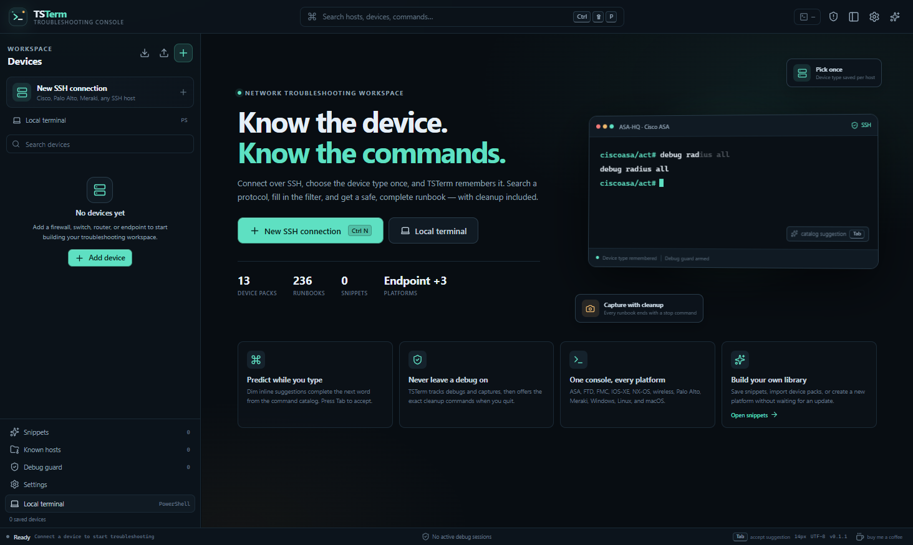

# TSTerm 0.1.0

**Know the device. Know the commands.**

TSTerm is a desktop troubleshooting console for network and system engineers. This first release is the
version I wanted during the “can you jump on a call and look at this firewall?” part of the day.

## What you can do

- Open real SSH sessions or a local PowerShell/zsh/bash shell, with tabs, split panes, SFTP, local port
  forwarding, jump hosts, and session logs.
- Pick a device type once. TSTerm remembers it for that host and loads the right runbooks next time.
- Search by symptom: `radius debugs`, `packet capture`, `bgp`, `dns`, `pktmon`, `vpn`, and so on.
- Fill in a filter, preview the exact commands and cleanup, then copy or send them.
- Type naturally. A dim next-word prediction appears from the active device pack, your snippets, and the
  session history. `Tab` accepts it.
- Start a debug or capture with confidence. TSTerm tracks it and asks what to do before you quit — then
  sends the cleanup to connected sessions or copies it for a device that is already gone.

## Included device packs

Cisco ASA, IOS/IOS-XE, Nexus, FTD, FMC, AireOS wireless, Catalyst 9800, Meraki, Palo Alto PAN-OS, Windows,
Linux, macOS, and a generic fallback. That is 13 packs and 180 runbooks in the first release.

You can add your own platform from **Settings → Data & packs → New device type**, or import a JSON pack.
Packs are validated, extendable, and stored outside the app bundle so updates will not overwrite them.
See [docs/DEVICE_PACKS.md](https://github.com/issacjohn/tsterm/blob/main/docs/DEVICE_PACKS.md).

## Install

Download **TSTerm Setup 0.1.0.exe** below and run it.

The installer is unsigned for this first release, so Windows SmartScreen may ask you to confirm. The app
does not install anything else or start at login. Source and build instructions are in the
[README](https://github.com/issacjohn/tsterm#install-and-run).

## Verified in the lab

Tested against a **Cisco ASA Software 9.24(10)** appliance: SSH login, first-use host key verification,
remembered device type, the RADIUS runbook, live `debug radius all` / `undebug radius all` cleanup on quit,
and the cleanup file. The automated UI test also covers the local PowerShell, snippets, custom device pack
creation, both themes, inline predictions, the quit guard, SFTP/port-forwarding dialogs, and the packaged
Windows build.

## A note on updates

TSTerm checks the latest GitHub release once a day. If a newer version exists, it offers a download. You can
skip that version, check manually from Settings → About, or turn automatic checks off. Nothing is installed
without you.

## Thanks

If TSTerm saves you a little time, there is a coffee link in the status bar:
[buymeacoffee.com/issac_john](https://buymeacoffee.com/issac_john). No pressure — go close the incident.
