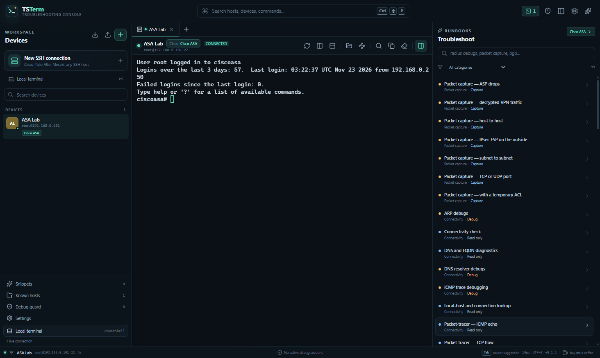

# TSTerm 0.1.1

**More ASA. More answers.**

This is a catalog update for anyone who spends their day on a Cisco ASA. The ASA pack grew from 21 to
**77 runbooks**, and several of the capture and debug recipes were corrected after testing them on a live
ASA 9.24(10).

## New in the ASA pack

- Packet capture: ASP drops, decrypted VPN traffic, encrypted ESP with a temporary ACL, plus the existing
  host, subnet, port, and ACL captures.
- VPN: user-filtered and by-index sessions, AnyConnect/WebVPN profile state, WebVPN debugs, IKEv1 and
  IKEv2 status and debugs, IPsec peer and SA checks, site-to-site health, certificates, SSL/TLS state, and
  load balancing.
- AAA: TACACS+, LDAP, AAA authentication/authorization/accounting debug runbooks, server-group protocol
  views, User-Identity mappings, and a management access audit.
- Routing: OSPF, EIGRP, BGP, BGP and EIGRP debugs, multicast (PIM/IGMP/MFIB), IPv6, and a route table
  summary.
- Policy: NAT/xlate detail, ACL hit counts, object groups, MPF inspection policy, connection tables, and
  DHCP status.
- Interfaces and HA: interface counters, ARP/MAC/bridge tables, failover detail, clustering status,
  hardware/inventory/boot/storage, NTP/logging, SNMP, Smart Licensing/call-home, threat detection,
  NetFlow, process/memory detail, SSH/ASDM management, configuration evidence, and tech-support.
- Debug cleanup now consistently uses the verified `undebug` form.

## Fixed after lab testing

- ASA capture buffers are set **after** the capture is created with
  `capture TSTCAP buffer 33554432`. The previous inline `buffer bytes` form is not accepted on ASA 9.24.
- ACL captures use `capture ... access-list TSTCAP_ACL` and clean up with
  `clear configure access-list TSTCAP_ACL`.
- ASA debugs were tested as enable/disable pairs and `show debug` was confirmed clean afterward.
- The ASA was left with no active debugs and no captures.

## Also

- The full catalog is now **13 device packs and 236 runbooks**.
- The Windows installer is included below. It is still unsigned, so SmartScreen may ask for confirmation.
- Installed 0.1.0 copies will see this release through the daily/manual update check.

## Thanks

If this saves you a call, the coffee link is still there:
[buymeacoffee.com/issac_john](https://buymeacoffee.com/issac_john).
