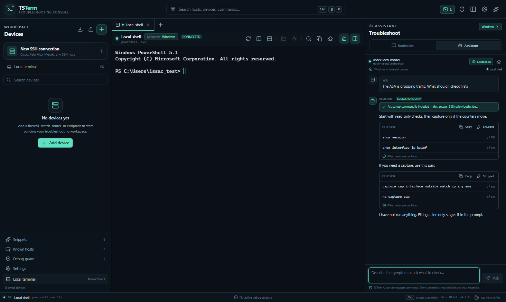

# TSTerm 0.2.0

**A troubleshooting partner that cannot touch the keyboard.**

TSTerm now has an optional AI assistant. It can hold a conversation about the symptom, use the device
pack and recent terminal output as context, and prepare commands for you to review. It has **no terminal,
SSH, file, or IPC execution access**, and it is **off until you enable it**.

## AI troubleshooting partner

- **Off by default.** A separate opt-in in **Settings → AI assistant**.
- **Local first.** Built-in profiles for Ollama (`127.0.0.1:11434/v1`) and LM Studio
  (`127.0.0.1:1234/v1`). No account needed.
- **Bring your own subscription.** Add any OpenAI-compatible endpoint or Anthropic Messages API, with
  selectable auth headers (`Authorization: Bearer`, `x-api-key`, `api-key`, or none).
- **Model discovery.** Fetch the model list from the configured endpoint instead of typing it from memory.
- **Encrypted keys.** API keys use Electron `safeStorage` (Windows DPAPI, macOS Keychain, Linux libsecret)
  and are never returned to the renderer. If the OS keychain is unavailable, a key is kept in memory for
  the session only.
- **Conversation context.** Optionally include the device type, matching TSTerm runbook hints, the current
  command line, and the last 80 terminal lines. Password/secret lines, ANSI, control characters, bidi
  overrides, and private-key blocks are removed before anything is sent.

## The execution boundary

The safety model is structural, not just a prompt instruction:

- The AI service lives in the Electron main process and only has a settings store. It has no session
  manager, PTY, SSH client, filesystem tools, or IPC handlers.
- Responses are plain text and fenced command blocks. Nothing is rendered as HTML or executed.
- **Fill** writes **one line** to the active prompt and never appends Enter. It refuses to write at a
  password prompt or while a full-screen program is open.
- Multi-line blocks cannot be filled at once. Every line is a separate user click, followed by the user's
  own Enter.
- Command parsing strips device prompts, ANSI escapes, C0/C1 controls, bidi overrides, zero-width
  characters, and overlong lines.
- **Copy** and **Snippet** are explicit actions. Runbooks and the debug guard are unchanged.

Every fill shows: “Nothing was executed. Review it and press Enter yourself.”

## Also in this release

- Assistant tab in the troubleshooting panel, with a clear **OFF** badge until enabled.
- `Ctrl/Cmd + Shift + A` opens the assistant or the AI setup page.
- Assistant action in the command palette and Session menu.
- Provider editor with Local/Remote status, temperature, max tokens, and model discovery.
- New tests: 44 unit tests, plus an end-to-end AI smoke test against a loopback mock model.
- The existing 13 device packs / 236 runbooks are unchanged.

## Verification

- `npm run typecheck`
- `npm test` — 44 tests across catalog, suggestions, updates, AI parsing/redaction, the AI execution
  boundary, and settings/key migration.
- `npm run build`
- `npm run test:ai` — enables the assistant, saves a key, fetches models, sends a chat request to a local
  mock provider, verifies the system-prompt guardrails, fills exactly one command without pressing Enter,
  and confirms the opt-in state returns after disabling.
- `npm run test:packaged` — packaged Windows app local-shell smoke.

The Windows installer is unsigned, so SmartScreen may ask for confirmation. Installed 0.1.x copies will
see this release through the manual or daily update check.

## Support

If TSTerm saves you a call: [buymeacoffee.com/issac_john](https://buymeacoffee.com/issac_john).
