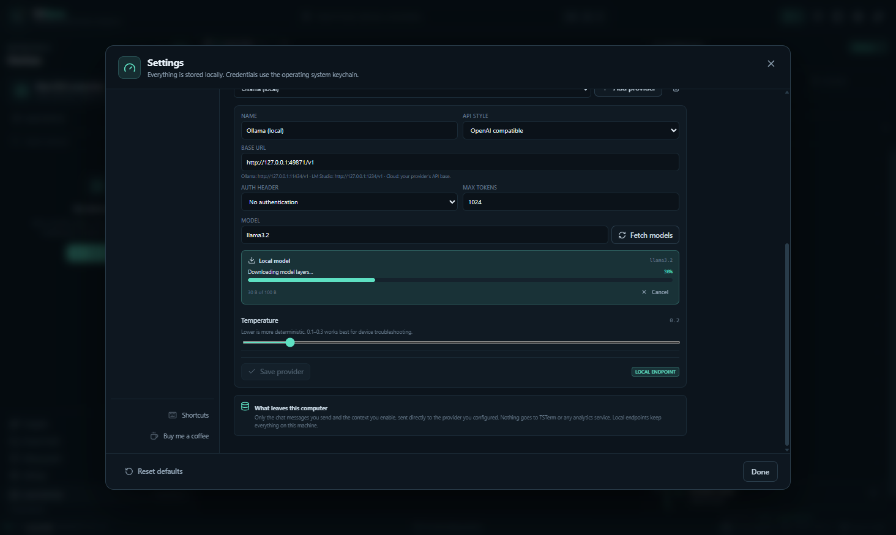

# TSTerm 0.2.1

**Enable it, and the local model installs itself.**

Ollama setup no longer needs a terminal. When the AI assistant is enabled with an Ollama profile, TSTerm
checks the local server for the selected model and automatically downloads it through Ollama's pull API.

## Automatic local model provisioning

- **Checks before chat.** TSTerm reads Ollama's `/api/version` and `/api/tags` before enabling the model.
- **Pulls only when needed.** A missing model starts one `/api/pull` request with `stream: true`.
- **Live progress.** Shows the current stage, percentage, downloaded size, and total size.
- **Cancel any time.** Completed layers are preserved by Ollama, so a retry resumes rather than starting
  over.
- **Runs in the background.** Closing Settings does not stop the download; TSTerm notifies you when the
  model is ready.
- **Chat unlocks automatically.** The composer stays disabled until Ollama lists the model as installed.
- **You stay in control.** A new **Download local models automatically** toggle is on by default. Turn it
  off to require an explicit **Download model** click.
- **Ollama only.** Downloads are restricted to loopback Ollama endpoints. LM Studio and other local
  servers manage their own models. Ollama itself still needs to be installed once; if it is missing or
  not running, TSTerm shows **Retry** and **Get Ollama**.

The execution boundary is unchanged: downloading a model is not terminal access. The AI service still has
no terminal, SSH, file, or IPC execution surface, and command fills still never press Enter.

## Verification

- `npm run typecheck`
- `npm test` — **54 tests** covering catalog, suggestions, updates, AI request shapes, command parsing and
  redaction, the AI execution boundary, settings/key migration, loopback detection, Ollama status, streamed
  pull progress, pull errors, and unsafe model names.
- `npm run build`
- `npm run test:ai` — provider/key/chat/fill boundary against a mock OpenAI-compatible model.
- `npm run test:ai-local` — full Ollama simulation: automatic pull, progress in Settings and the Assistant
  panel, background completion after closing Settings, and chat using the pulled model.
- `npm run test:packaged` — packaged Windows app local-shell smoke.
- `npm run test:update` — live GitHub release check.

The Windows installer is unsigned, so SmartScreen may ask for confirmation. Installed 0.2.0 copies will
see this release through the daily or manual update check.

## Support

If TSTerm saves you a call: [buymeacoffee.com/issac_john](https://buymeacoffee.com/issac_john).
