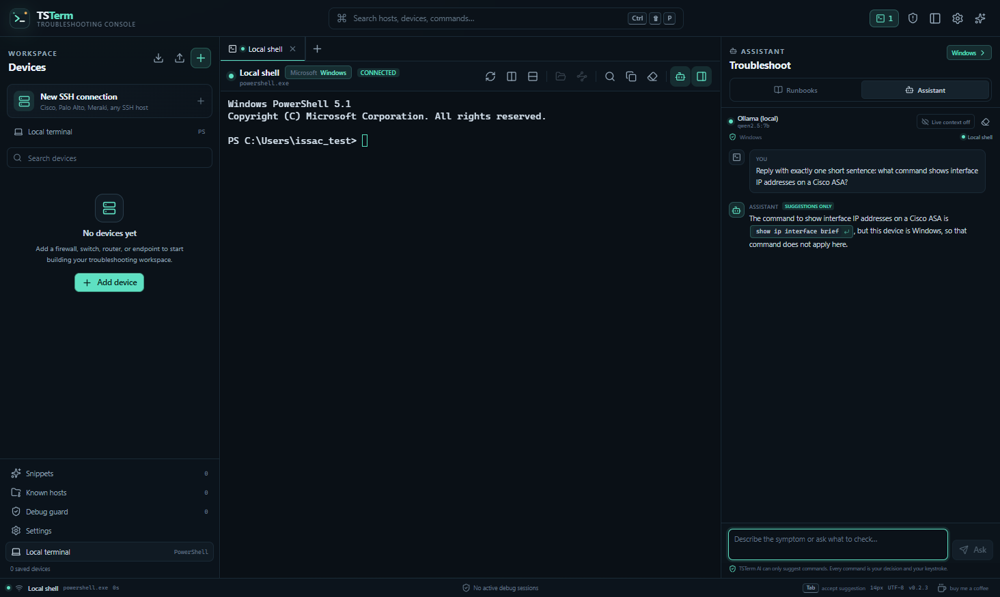

# TSTerm 0.2.3

**Answers appear while the model is still typing.**

This release fixes the feeling that local AI is slow, and gives the model much better device context.

## Streaming responses

TSTerm now requests a streaming response from Ollama and OpenAI-compatible/Anthropic providers. Tokens
appear in the chat as they are generated, with a blinking cursor, instead of leaving a typing indicator
until the entire answer is finished.

- **OpenAI-compatible SSE** and **Anthropic SSE** are parsed incrementally.
- Chunks are batched to about 20 UI updates per second to keep the renderer smooth.
- **Stop** keeps the partial answer so far instead of discarding it.
- Providers that ignore `stream: true` and return one JSON response still work.

On the verified machine (RTX 2080 Super, 8 GB VRAM, 32 GB RAM), Ollama loaded Qwen2.5 7B fully on the GPU
and generated about **69 tokens/sec**. The old UI waited for the whole generation before showing anything;
that was the main source of the “slow” feeling.

## Better answers

- **Runbook knowledge is always included**, even when live terminal context is off. Device type, device
  notes, matching runbooks, and a compact catalog index are local, trusted data; only terminal lines remain
  opt-in.
- The prompt now asks for a likely cause, exact read-only checks, what each result proves, and only then a
  change with risk and cleanup.
- It explicitly forbids mixing ASA, IOS-XE, NX-OS, PAN-OS, Windows, and Linux syntax.
- It tells the model to say when it is unsure instead of inventing commands.
- Up to six relevant runbooks are included, with a category/title index when the question is vague.

## Better model defaults and guidance

- Recommended model chips: **Qwen2.5 7B** (default recommendation), **Llama 3.1 8B**, Qwen2.5 3B, and
  Llama 3.2 3B.
- Selecting a chip saves the profile and starts the automatic model download if needed.
- A visible warning appears for 1B–3B models: they are fast but often give generic answers.
- Command-like inline code (for example `` `show ip interface brief` ``) is now rendered as a clickable
  **Fill** chip, so answers from smaller models do not lose the no-Enter workflow just because the model used
  inline backticks instead of a fenced block.
- The local model test uses real Qwen2.5 7B on Ollama.

## Verification

- `npm run typecheck`
- `npm test` — **64 tests**, including streaming OpenAI and Anthropic SSE, non-streaming fallback, model
  quality detection, inline command detection, runbook context without live terminal data, installer and
  pull flows, and the execution boundary.
- `npm run build`
- `npm run test:ai` — mock provider now streams SSE; verifies fill-without-Enter.
- `npm run test:ai-local` — mock Ollama automatic pull and chat.
- `npm run test:ai-runtime` — missing-runtime Install Ollama UI.
- `npm run test:ai-ollama` — real Ollama/Qwen2.5 7B streaming chat through TSTerm.
- `npm run test:packaged` — packaged Windows app local-shell smoke.
- `npm run test:update` — live GitHub release check.

The Windows installer is unsigned, so SmartScreen may ask for confirmation. Installed 0.2.2 copies will
see this release through the daily or manual update check.

## Support

If TSTerm saves you a call: [buymeacoffee.com/issac_john](https://buymeacoffee.com/issac_john).
