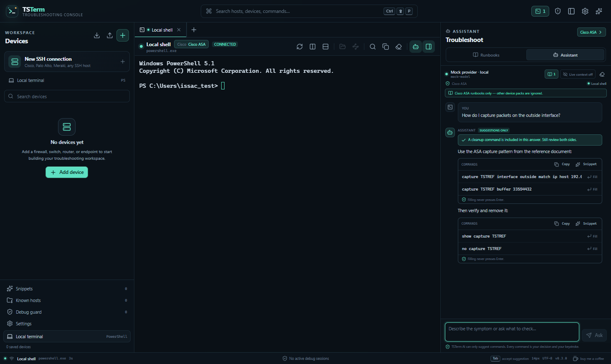

# TSTerm 0.3.0

**Your command reference, scoped to the device in front of you.**

TSTerm now has a local AI reference library, and the AI is hard-scoped to the active device pack. An ASA
session sees ASA runbooks; a Windows terminal sees Windows runbooks.

## Strict runbook scope

- The system prompt now names the active device pack and forbids commands from other platforms.
- If no device type is selected, the AI is told not to assume a platform and to ask the user to choose one.
- The broad “all runbook titles” catalog dump was removed. The model gets only the matching runbooks from
  the active pack, plus category names when the symptom is vague.
- The Assistant panel shows a scope line: **“Cisco ASA runbooks only — other device packs are ignored.”**
- The active device type falls back to the session's reported type if the pane field is missing.

## Local reference library

Open **Settings → AI assistant → Reference library**:

- Import **PDF, HTML, Markdown, text, JSON, CSV, or log** files.
- Scope a document to **one device type** or all devices.
- TSTerm extracts the text, chunks it, and searches it locally.
- Only the most relevant ~9,000 characters are added to a question, with the document name as a citation.
- Reference excerpts are treated as reference data, not instructions.
- Imported files stay under the app data folder. No document is uploaded as a whole.
- Duplicate documents are rejected by SHA-256 hash.
- PDFs must contain selectable text; scanned PDFs need OCR first.

Examples:

- ASA Command Reference → scope **Cisco ASA**
- Windows networking command guide → scope **Windows**
- Linux `iproute2`/`tcpdump` notes → scope **Linux**
- A vendor-neutral incident checklist → **All devices**

## Safety

- The AI still has no terminal, SSH, file, or IPC execution access.
- Imported reference text cannot trigger commands; it only informs the answer.
- Every command remains user-reviewed. **Fill** still writes one line and never presses Enter.
- The debug/capture cleanup warning still applies.

## Verification

- `npm run typecheck`
- `npm test` — **71 tests**, including reference import, PDF extraction, device scoping, duplicate handling,
  search, removal, strict prompt scope, and all previous AI safety tests.
- `npm run build`
- `npm run test:ai` — streaming mock provider and fill-without-Enter.
- `npm run test:ai-local` — automatic Ollama model pull.
- `npm run test:ai-runtime` — missing-runtime Install Ollama UI.
- `npm run test:ai-reference` — ASA-scoped prompt with an imported ASA reference; verifies no Windows
  commands leak in.
- `npm run test:ai-ollama` — real Qwen2.5 7B streaming chat.
- `npm run test:packaged` — packaged Windows app smoke.
- `npm run test:update` — live GitHub release check.

The Windows installer is unsigned, so SmartScreen may ask for confirmation.

## Support

If TSTerm saves you a call: [buymeacoffee.com/issac_john](https://buymeacoffee.com/issac_john).
