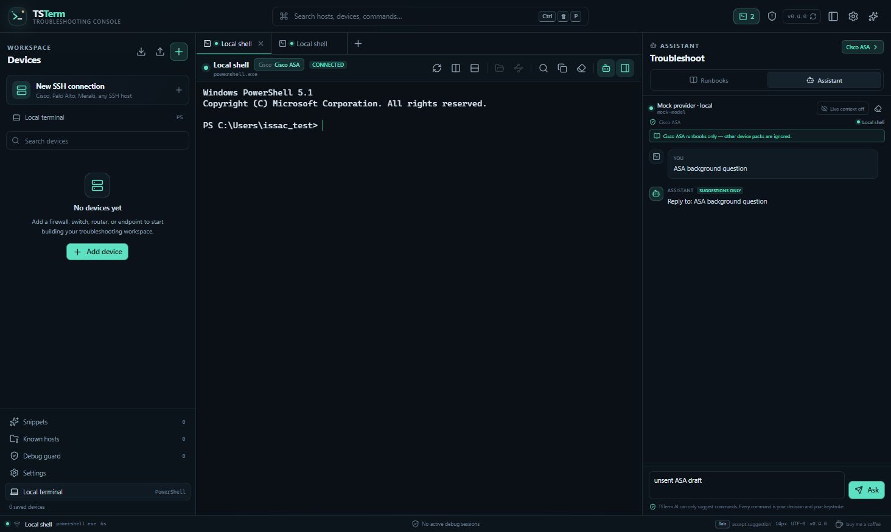

# TSTerm 0.4.0

**One AI conversation per terminal, plus the version and update check at the top.**

Switch from an ASA session to a Windows shell and each tab keeps its own AI thread. Go back and your
messages, draft, and even an answer that finished in the background are exactly where you left them.

## Per-terminal AI threads

- Each terminal pane has its own messages, draft, busy state, streamed text, and error.
- Switching tabs no longer shares or mixes conversations.
- A reply that streams while you are on another tab is routed back to the terminal that asked.
- Returning to a terminal restores the conversation and any unsent draft.
- Closing a tab cancels its in-flight request and discards that thread.
- The scope remains per terminal: ASA thread gets ASA runbooks, Windows thread gets Windows runbooks.
- The local model is reused across threads. Ollama keeps one model in VRAM rather than starting a
  duplicate model process for every tab, so conversations are isolated without wasting GPU memory.

Conversations are kept while the terminal tab is open. Quitting TSTerm clears the threads.

## ASA-only catalog for now

- The bundled catalog now contains **Cisco ASA only** — 77 runbooks across 14 categories.
- The other device packs were moved to `catalog-archive/` and are no longer installed or sent to the AI.
- They can be restored one at a time after the ASA pack is fully validated.
- Custom packs can still be imported and used normally.

## Better ASA command grounding

- The top-level ASA command index is included only in ASA-scoped prompts, with command descriptions and
  safe `?` discovery examples.
- The capture syntax warning now catches invalid `source`, `destination`, and `duration` forms and points to
  the valid `match ip host ...` / `match ip <src> <mask> ...` forms.
- Runbook retrieval now strips IP addresses, port numbers, and filler words before searching, so a question
  like “capture 1.1.1.1 port 53 to 8.8.8.8” still finds the ASA capture runbooks.
- **Ollama context window raised from 4,096 to 16,384 tokens.** The OpenAI-compatible endpoint silently
  truncates at 4,096, which could discard the exact runbook or reference section. TSTerm now uses Ollama’s
  native `/api/chat` with `num_ctx: 16384`.
- Runbook and reference context budgets were reduced and ranked so the prompt fits comfortably.
- The Reference library supports importing the official Cisco ASA command reference PDFs, scoped to ASA,
  for exact subcommands and examples. A **Cisco docs** shortcut opens the official command reference page.

## Version and update check at the top

- The top bar now shows the current version (`v0.4.0`) at all times.
- A refresh button next to it checks GitHub for a newer release.
- If an update exists, the update dialog opens; otherwise a toast confirms you are current.
- The Settings → About check and command-palette action still work.

## Verification

- `npm run typecheck`
- `npm test` — **77 tests**, including per-thread store isolation, ASA command retrieval with IP/port
  questions, native Ollama context settings, and capture syntax warnings.
- `npm run build`
- `npm run test:ai-threads` — two terminals, ASA and Windows; verifies draft restoration, background
  streaming, and no context leakage.
- `npm run test:ai-reference` — scoped ASA reference retrieval.
- `npm run test:ai` / `test:ai-local` / `test:ai-runtime` / `test:ai-ollama` — streaming, model install,
  missing-runtime UI, and real Qwen2.5 7B.
- `npm run test:packaged` and `npm run test:update`.

The Windows installer is unsigned, so SmartScreen may ask for confirmation.

## Support

If TSTerm saves you a call: [buymeacoffee.com/issac_john](https://buymeacoffee.com/issac_john).
